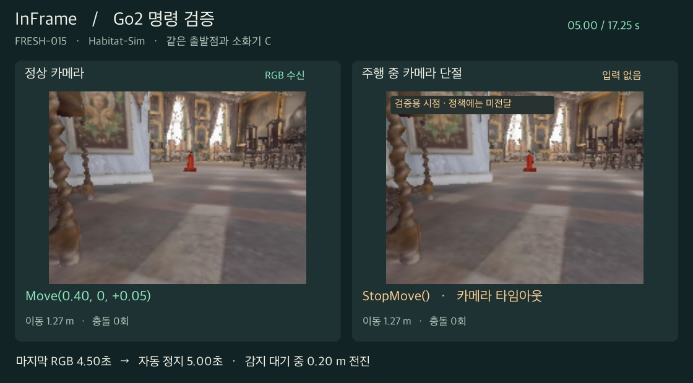

# InFrame

**전방 카메라로 소화기를 찾아, 점검 사진을 남길 수 있는 자리에서 스스로 멈추는 실내 ObjectNav 시스템.** RGB-D SLAM으로 만든 지도에서 실물 소화기 A·B와 사진을 연결하고, 넓은 실내 스캔에서는 지도 기반 교사의 주행을 학생 정책에 가르쳤다. 학생에게 들어가는 외부 입력은 RGB와 목표명이다.

[0~7단계 실행 가이드](RUNBOOK.md) · [실행 파일과 데이터 받기](https://github.com/Dabin0312/InFrame/releases/tag/v0.7.0) · [프로젝트 페이지](https://dabin0312.github.io/InFrame/)

**주행 영상**　[교사의 10 m 접근](https://github.com/Dabin0312/InFrame/raw/refs/heads/main/evidence/teacher-run.mp4) · [단일 프레임과 4스텝 학생 비교](https://github.com/Dabin0312/InFrame/raw/refs/heads/main/evidence/student-comparison.mp4) · [회전 실패를 고친 사례](https://github.com/Dabin0312/InFrame/raw/refs/heads/main/evidence/recovered-turn.mp4) · [개선 후에도 실패한 사례](https://github.com/Dabin0312/InFrame/raw/refs/heads/main/evidence/remaining-failure.mp4) · [정상 정지와 카메라 단절 비교](https://github.com/Dabin0312/InFrame/raw/refs/heads/main/evidence/go2-stop.mp4)

## 단계별로 무엇을 확인했나

| 단계 | 입력 → 결과 | 확인할 기록 |
|---|---|---|
| 0. 과제 | 목표는 소화기. 정책이 STOP을 내고, 등록 관측점까지 주행 거리 0.8 m 이내이며, 그 관측점의 물체가 마지막 RGB에서 보여야 성공이다. | [판정 규칙과 본시험 계획](stages/00-task/) |
| 1. 시각 SLAM | 7-Scenes Fire 두 시퀀스에서 각각 80/80프레임을 추적했다. 첫 자세를 정렬한 위치 오차 RMSE는 각각 1.93 cm, 2.60 cm였다. | [Fire 궤적·재위치 결과](evidence/fire-slam.json) · [단안 SLAM 실행 방법](stages/02-visual-slam/) |
| 2. 의미 지도 | 실물 소화기 A·B에 사진을 연결했다. 45장에 보이는 소화기 82개 중 올바른 마스크와 ID가 55→77개, 추가 10장에서는 18/20개였다. 두 집합 모두 잘못 연결한 ID는 0개다. | [사진별 정답·누락·연결 ID](evidence/fire-photo-links.json) |
| 3. 통과 판정 | Fire 지도와 A·B를 같은 좌표로 Habitat에 옮겼다. 차단 구간 3/3, 통과 구간 2/3이 참고 판정과 일치했다. 통과 구간 한 곳의 일부를 막힌 것으로 판정했다. | [구간별 검사](evidence/fire-traversability.json) |
| 4. 교사 | Fire의 연결 면적은 약 0.026 m²였다. 장거리 학습에는 Skokloster Castle 스캔에 배치한 소화기 C를 사용했다. 성의 학습 300회 중 297회, 검증 60회 중 60회 성공. Fire 근접·의도적 실패를 포함해 386회 기록했다. | [전체 시범 검증](evidence/teacher.json) |
| 5. 학생 | 성공 시범 297개로 모방학습했다. 같은 검증 출발점 60곳에서 단일 프레임 46/60, 4스텝 50/60 성공. 두 학생이 함께 실패한 곳은 10곳이다. | [정책별 성공·충돌·시간 초과](evidence/student.json) |
| 6. 실패 개선 | 학습 구역에서 제자리 회전·경계 충돌을 재현하고 정책을 보완했다. 별도로 남겨 둔 같은 출발점 60곳에서 개선 전 38/60 → 개선 후 51/60. 충돌 한도 실패 13→6회, 회전 반복 실패 9→3회. | [쌍별 비교 요약](evidence/recovery.json) |
| 7. Go2 연결 전 검증 | 동결한 정책을 모의 어댑터에 연결했다. 같은 60곳에서 성공 51, 충돌 한도 6, 시간 초과 3. 기준 RGB 70장에 대한 정책 출력은 70/70 일치했다. | [출발점별 CSV](evidence/go2-runs.csv) · [폐루프 결과](evidence/go2-sim.json) · [정지 명령 시각](evidence/go2-safety.json) |

## 실물에서 남은 검증

실제 공간에서 수집된 자료는 **Fire의 RGB-D와 A·B 사진**이다. 성의 주행은 한 건물·한 목표 종류의 시뮬레이션이며, 성공 표의 최종 가시성은 깊이와 객체 ID 투영으로 자동 판정했다. 7단계의 60곳은 6단계 출발점을 재사용한 어댑터 회귀 시험이다.

- **Go2 카메라·주행**　실제 영상의 화각·왜곡·장착 자세와 지연을 측정하고, 전진·좌우 회전 방향, 명령 속도와 실속도, STOP 후 실제 제동거리를 대조한다.
- **단절과 정지**　호스트 모의 시험에서 카메라 무응답 10/10회에 마지막 유효 요청 후 501.12~504.42 ms에 정지 명령이 호출됐다. DDS 연결 자체가 끊겼을 때의 기체 측 정지와 물리적 감속은 실기로 측정해야 한다.
- **현장 점검**　실제 복도 통과 3곳·차단 3곳을 실측하고, 정지 사진의 동일 객체를 독립 판독자 2명이 판정한다. 소화기·의자·쓰레기통 3종 × 미학습 출발 자세 20개의 최종 시험도 남아 있다.

전체 주행 프레임, 에피소드별 마지막 사진, 체크포인트, 오프라인 비교 화면은 릴리스에 들어 있다. [실행 가이드](RUNBOOK.md) · [데이터 출처와 이용 조건](DATA-NOTICES.md)
