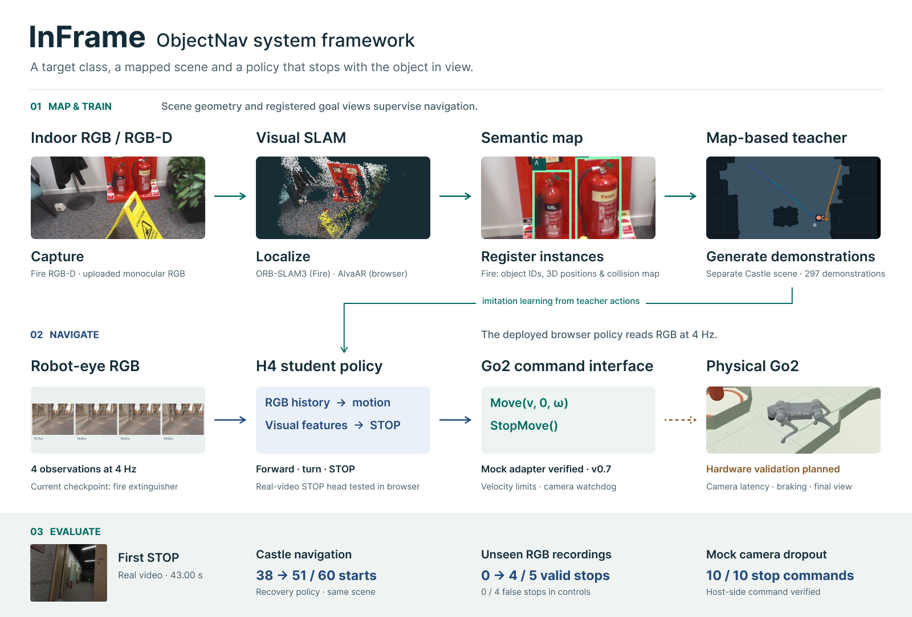

# InFrame

**실내 의미 지도와 전방 RGB에 기반한 목표 객체 탐색 및 정지(ObjectNav).**

InFrame은 지정된 종류의 물체가 보이는 자리까지 이동하고, 첫 STOP 사진을 지도 위의 개체와 연결합니다. 공개 데모에서 소화기·의자·쓰레기통을 선택할 수 있습니다. Castle의 동일 출발 자세에서 지도 기반 주행을 비교하고, 촬영한 영상에서는 목표별 관측과 첫 STOP을 확인합니다.

[Project page](https://dabin0312.github.io/InFrame/) · [Try your own data](https://dabin0312.github.io/InFrame/demo/) · [주행 영상](https://dabin0312.github.io/InFrame/#run) · [Data & models](https://github.com/Dabin0312/InFrame/releases/tag/v0.7.0)

<picture></picture>

## Try your own data

[새 공개 영상 9편의 정책 비교](https://dabin0312.github.io/InFrame/h4/) · [공개 실내 영상의 결과 열기](https://dabin0312.github.io/InFrame/demo/?example=approach) · [내 영상으로 실행](https://dabin0312.github.io/InFrame/demo/) · [Go2 주행 직접 실행](https://dabin0312.github.io/InFrame/#live)

촬영한 MP4를 선택하면 카메라 영상, 그 영상에서 복원한 단안 SLAM 지도, 정지 장면을 함께 볼 수 있습니다. 지도에서 물체 ID를 선택하면 관측한 프레임으로 이동합니다. 의자·쓰레기통은 YOLOE의 범주별 출력과 동일 개체의 연속 관측으로 정지 장면을 고릅니다. 기존 H4와 실영상으로 정지 행동을 학습한 H4의 첫 STOP을 비교할 수 있습니다. 영상은 브라우저에서 처리하며 관측과 지도는 JSON으로 저장할 수 있습니다.

[전시장 의자 영상 실행](https://dabin0312.github.io/InFrame/demo/?goal=chair&example=chair) · [엘리베이터 앞 쓰레기통 영상 실행](https://dabin0312.github.io/InFrame/demo/?goal=bin&example=bin) · [동일 출발점 세 목표의 경로와 정지 사진](https://dabin0312.github.io/InFrame/#goal-comparison) · [검증 수치와 경로 좌표](project/goal-runs.json)

## Method

1. **Semantic SLAM.** 7-Scenes Fire의 RGB-D 궤적과 분할 마스크를 결합해 실물 소화기 A·B를 지도에 등록하고 서로 다른 시점의 사진을 연결합니다.
2. **ObjectNav.** Skokloster Castle 스캔에 소화기 C를 배치하고 지도 기반 교사의 성공 시범 297개로 학생 정책을 학습합니다. 개선한 4스텝 정책은 같은 건물의 예약 출발점 60곳 중 51곳에서 소화기가 보이는 위치에 정지했습니다.
3. **Go2 interface.** 같은 정책을 모의 어댑터에 연결해 RGB 입력, 속도 제한, 정지 명령을 검증했습니다. 실제 기체 주행은 후속 평가입니다.

## Run locally

[릴리스](https://github.com/Dabin0312/InFrame/releases/tag/v0.7.0)에서 전체 재현용 `inframe-stages-0-7.zip` 또는 모의 어댑터용 `inframe-go2-mock.zip`을 받으세요. 전체 묶음은 압축을 풀고 [환경 설정](RUNBOOK.md)을 마친 뒤 아래 명령으로 실행합니다.

```sh
python3 reproduce.py all
```

[단계별 실행 방법](RUNBOOK.md) · [검증 기록](evidence/) · [데이터 출처 및 라이선스](DATA-NOTICES.md)
